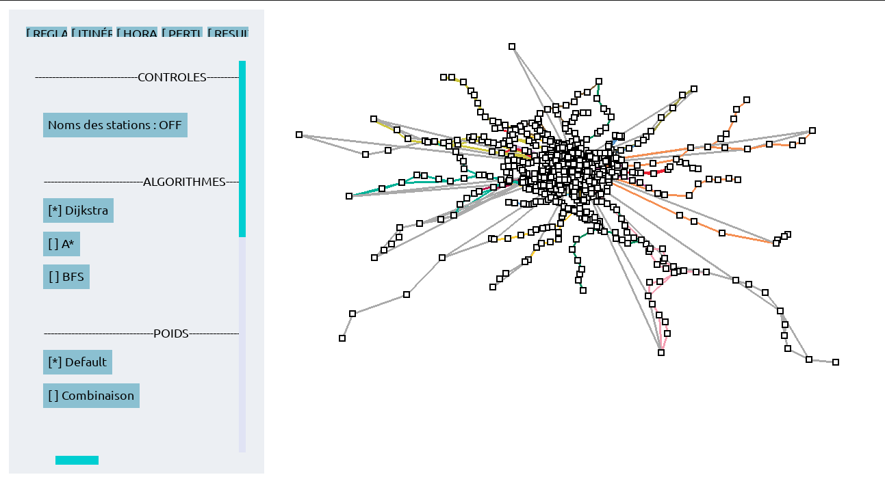
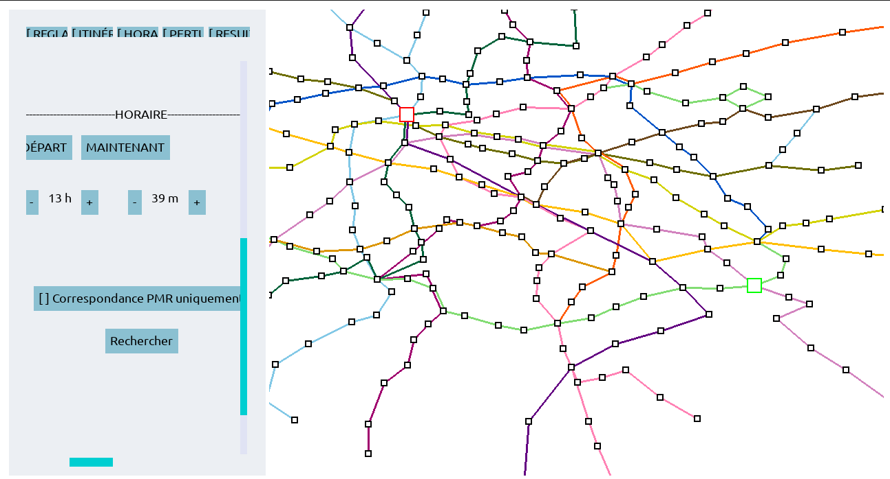
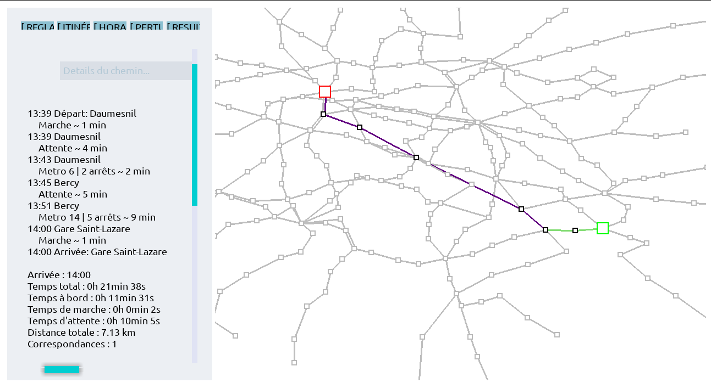

# MetroCaml - Moteur de recherche d'itinéraires et Bibliothèque de Graphes en OCaml

*Projet universitaire de L2 Informatique (Double Licence Maths-Info). Validé avec la note de 19/20 (Major de promotion, 1er/56).*





## Présentation du projet

MetroCaml est un projet OCaml articulé autour de trois composantes :

1. **`routing/`** : Une **bibliothèque de théorie des graphes générique** et hautement optimisée, utilisant des foncteurs et interfaces (`GRAPH`, `NODE`, `EDGE`) pour s'adapter à n'importe quel contexte de modélisation.

2. **`metrocaml/`** : Une implémentation métier (GUI et CLI) de cette bibliothèque en un **moteur de recherche d'itinéraires multimodal** s'appuyant sur le standard universel de transport **GTFS**.

3. **`tiktocaml/`** : Un projet satellite démontrant la flexibilité de l'architecture en appliquant les mêmes algorithmes de routage à l'analyse d'un réseau social (liens d'amitié).

## Architecture & Conception technique

Ce projet démontre une maîtrise avancée du paradigme fonctionnel et de l'architecture logicielle en OCaml.

* **Algorithmique optimisée :** Implémentation d'algorithmes de routage par état (A\*, Dijkstra, BFS). Pour garantir des performances élevées (même sur des millions d'appels), nous avons développé un **tas d'appariement (Pairing Heap) sur mesure** (insertion en *O(1)*), un système de hachage spécialisé bypassant le polymorphisme d'OCaml, et un filtrage dynamique des transitions (ex: exclusion PMR sans altérer le graphe).

* **Modèle de données & Temps Réel (GTFS-RT) :** Le graphe des transports est généré dynamiquement en parsant des archives GTFS (CSV). Le réseau francilien intègre un **thread parallèle** requêtant l'API PRIM d'Île-de-France Mobilités pour injecter les perturbations en temps réel sans bloquer le moteur de calcul.

* **Architecture MVC & Indépendance :** L'interface graphique (GUI) possède son propre modèle MVC interne. L'abstraction est totale : la GUI ignore la structure du graphe grâce à un adaptateur (`transport_view.ml`), rendant le moteur de rendu réutilisable pour n'importe quel autre projet.

* **Qualité et CI/CD :** Pipeline GitLab CI complète (Setup, Lint avec OCamlFormat, Tests unitaires avec Alcotest, Couverture avec Bisect_ppx > 70%).

## Installation et Lancement

### Lancer via l'exécutable

Vous pouvez télécharger l'archive `.zip` précompilée depuis la section [Releases](https://github.com/LouisMeynaud/Projet_L2_MetrOCaml/releases).
Extrayez l'archive, accordez les droits d'exécution et lancez le programme depuis le dossier extrait :
* pour MetroCaml :
```bash
unzip metrocaml-1.0.0.zip
chmod u+x metrocaml-1.0.0
./metrocaml-1.0.0
```
* pour TiktokCaml :
```bash
unzip tiktokcaml-1.0.0.zip
chmod u+x tiktokcaml-1.0.0
./tiktokcaml-1.0.0
```

### Compiler depuis le code source

Assurez-vous d'avoir l'environnement OCaml (`opam` et `dune`) installé.

```
git clone https://github.com/LouisMeynaud/Projet_L2_MetrOCaml.git
cd metrocaml
# Installation des dépendances du projet et des dépendances graphiques
opam install . --deps-only
opam install bogue graphics tsdl-ttf
# Compilation
dune build
# Exécution
dune exec metrocaml # ou tiktocaml

```

> **Mode En Ligne (Temps Réel Île-de-France)**  
> Pour profiter des perturbations en temps réel via l'API IDFM, vous devez créer votre propre clé API [ici](https://prim.iledefrance-mobilites.fr/fr). Pour cela, connectez-vous, cliquez sur votre profil, puis sur *Mes jetons d'authentifications* et *Générer mon jeton*.
> Copiez le fichier `.env.example` en le nommant `.env` à la racine du projet, et remplacez `CLE_API_IDFM_ICI` votre clé API.

## Fonctionnalités (MetroCaml)

Le moteur propose des calculs d'itinéraires multimodaux sur plusieurs réseaux (Toulouse, Montpellier, Marseille, SNCF, Corsica, et IDF en temps réel) :

* **Critères pondérés :** Optimisation selon le Temps, la Distance, le Nombre d'arrêts ou les Correspondances.

* **Combinateur de poids :** Utilisation de profils prédéfinis ("Rapide", "Confort") ou de pondérations personnalisées via le combinator mathématique.

* **Benchmarking intégré :** Outil permettant d'évaluer la rapidité (ms) et la pertinence mathématique entre Dijkstra et A\* sur des recherches aléatoires.

## L'Équipe et mes contributions

Projet réalisé avec Baptiste LORIOT, Matthys MONA, Thomas BRUNO, Léo DENQUIN et Lorenzo MOSCARDI.

**Mes contributions techniques spécifiques :**
* Implémentation des différents type de critère
* Implémentation de l'algorithme de Dijkstra
* Implémentation de l'algorithme BFS

## Licence

Ce projet est sous licence MIT (voir [LICENSE](LICENSE)).
